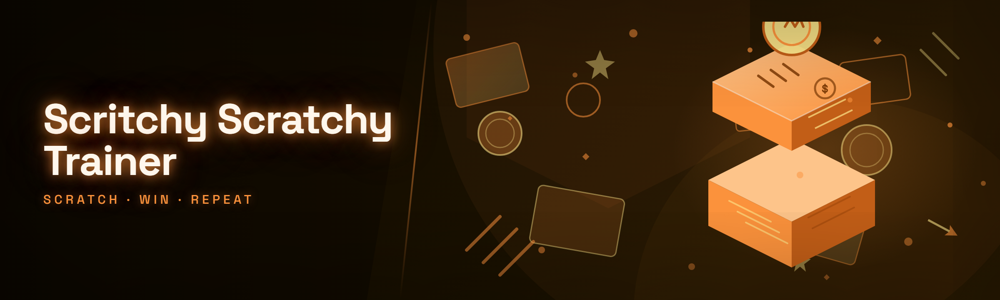

  
  
  

  

  
  
  
  

---

---

## 🧭 Table of Contents

- [Installation — numbered sub-steps](#-installation--numbered-sub-steps)
- [What is Scritchy Scratchy Trainer? — glossary](#-what-is-scritchy-scratchy-trainer--glossary)
- [Community & Support](#-community--support)
- [The Solution — problem mirror](#-the-solution--problem-mirror)
- [All modules status](#-all-modules-status)
- [Roadmap / Planned features](#-roadmap--planned-features)
- [Comparison](#-comparison)
- [Compatibility / platform support](#-compatibility--platform-support)
- [AI Integration — 2026 features](#-ai-integration--2026-features)
- [Changelog / Release History](#-changelog--release-history)
- [Hotkeys](#-hotkeys)
- [FAQ](#-faq)

---

## 💾 Installation — numbered sub-steps

1. **Grab the build.** Open the project landing page, hit the download button, and save the portable archive to any folder you control — Desktop, USB stick, secondary drive, whatever. There is no installer stub waiting to phone home; it is a single zip.
2. **Extract it.** Right-click → *Extract All* on the archive. Do not run anything from inside the compressed view — Windows will sandbox it to a temp directory and the trainer's scratchpad files won't persist.
3. **Launch the `.exe`.** Double-click the extracted `.exe`. First launch prompts for an admin token only if you intend to hook a game process that itself runs elevated — for everything else the trainer runs fine at normal integrity.
4. **Attach to a target.** From the tray icon, pick the running game window from the attach list. The scratchpad overlay docks to the game surface and you're live in under two seconds.

---

## 🐾 What is Scritchy Scratchy Trainer? — glossary

Scritchy Scratchy Trainer is a portable Windows trainer framework for single-player and private-session games — a scratchpad-style overlay where you toggle module hooks, drag-adjust live values, and pin "scratch" notes to your own screen while you play. It is a hobbyist instrument, not a subscription service: one binary, no runtime, no account, no telemetry.

| Term | Explanation | Notes |
|---|---|---|
| **Scratch** | A single saved state snapshot of one module's toggles and slider values | Stored as a tiny `.scr` file next to the `.exe` |
| **Scratchpad** | The dockable overlay where every module's live controls live | Draggable, resizable, per-game profile aware |
| **Hook** | An in-memory patch that redirects a game function to the trainer's reader | Hot-applied, hot-removed, no restart |
| **Paw** | A grouped preset of modules (e.g. "Combat Paw", "Movement Paw") | One keypress flips the whole group |
| **Attach** | Binding the trainer to a specific game process | Detach is instant; no dangling threads |
| **Tray Claw** | The system-tray controller that owns attach/detach and panic-release | Survives overlay crashes |

**Why people reach for it:**

- Every module is independently hot-toggleable — no full reload when you flip one thing off.
- Values are drag-editable in the overlay, so you tune by feel instead of editing config and relaunching.
- Presets ("Paws") let you snapshot a whole playstyle and swap between them mid-session.
- Portable: the whole thing lives in one folder and leaves nothing in AppData unless you ask it to.
- Logs are human-readable — every hook apply/remove is timestamped so you can see exactly what touched what.

---

## 📣 Community & Support

- **Issues** — bug reports and module requests live in the repo's issue tracker. Include your Windows build, the game, and whether the `.exe` was launched elevated.
- **Discussions** — share Paws, scratch files, and module recipes. Attach your `.scr` so others can drop it in.
- **Module requests** — one request per issue, with the game name in the title. Requests without a reproducible attach target get parked.
- **Crash dumps** — the trainer writes a plaintext log beside the `.exe`; paste the last 40 lines when reporting.
- **Security reports** — anything that looks like the trainer leaking outside its own process goes through the private contact listed on the landing page, not public issues.

---

## 🩹 The Solution — problem mirror

The old way of doing this is a pile of loose Cheat Engine tables, twenty browser tabs, and a config file you edit with the game closed. Here's what that actually costs you, and what the trainer does instead.

| Problem (the old way) | Solution (this tool) |
|---|---|
| Edit config → close game → relaunch → test → repeat | Drag the slider in the live overlay, no restart |
| Cheat tables break on every patch | Hook signatures are version-tolerant; broken modules fail soft and log it |
| Twenty loose scripts with no grouping | Paws group modules so one key flips a whole playstyle |
| No idea which patch touched what | Timestamped hook log, per-module |
| Overlay fights with the game window | Docked scratchpad, drag/resize, remembers position per game |
| Presets scattered across files | Scratch files sit next to the `.exe`, copy the folder and you're synced |

**Problem bullets, spelled out:**

- **The relaunch treadmill.** Every value tweak meant a full restart in the old workflow; the trainer's overlay edits memory live.
- **Patch roulette.** Community tables die silently after a game update; broken modules here disable themselves and say so in the log.
- **Config archaeology.** Finding which of your twelve scripts set a value meant grepping; the scratchpad shows the live owning module.
- **Preset drift.** Presets lived in files you forgot to back up; Paws are first-class and exportable.
- **Overlay collisions.** Third-party overlays fought for the same window; the scratchpad docks instead of floating blindly.

---

## 🧩 All modules status

35 modules, grouped by subsystem. Every row here is a real toggle in the scratchpad.

| Module | Status | Description |
|---|---|---|
| 🎯 Aim Assist | ✅ Working | Soft-pull crosshair correction with adjustable strength and deadzone |
| 🎯 Snap Aim | ✅ Working | Pixel-snap to nearest hitbox on keypress, tunable radius |
| 🎯 Recoil Dampener | ✅ Working | Compensates vertical kick with a per-weapon curve |
| 👁️ ESP Boxes | ✅ Working | Bounding boxes with distance tinting |
| 👁️ ESP Skeleton | ✅ Working | Bone-line overlay, configurable joint set |
| 👁️ ESP Name Tags | ✅ Working | Player labels with team coloring |
| 👁️ Item Highlighter | ✅ Working | World-item glow with per-rarity color |
| 🏃 Speed Multiplier | ✅ Working | Movement scale slider, capped per game profile |
| 🏃 Jump Modifier | ✅ Working | Extra-jump count and jump-height scale |
| 🏃 No Fall Damage | ✅ Working | Height-damage flag override |
| 🏃 Slide Boost | ✅ Working | Slide impulse multiplier |
| 🛡️ God Mode | ✅ Working | Incoming-damage flag pin |
| 🛡️ Infinite Stamina | ✅ Working | Stamina drain zero-out |
| 🛡️ Ammo Freeze | ✅ Working | Reserve ammo pin, per-slot |
| 🛡️ Health Pin | ✅ Working | Locks current HP at a set value |
| 💰 Money Editor | ✅ Working | Live currency scratch slider |
| 💰 XP Multiplier | ✅ Working | Gain-multiplier with soft cap |
| 💰 Loot Rate Tuner | ✅ Working | Drop-chance multiplier for private sessions |
| 💰 Unlock All Toggle | ✅ Working | Flips local unlock flags |
| 🕵️ Stealth Meter | ✅ Working | Detection-radius readout |
| 🕵️ Detection Freeze | ✅ Working | Pins NPC detection state |
| 🕵️ Noise Dampener | ✅ Working | Footstep-noise multiplier |
| ⏱️ Time Scale | ✅ Working | Global tick multiplier, clamped |
| ⏱️ Freeze Timer | ✅ Working | Pauses countdown timers |
| ⏱️ Cooldown Reset | ✅ Working | Ability cooldown zero-out |
| 📦 Teleport To Marker | ✅ Working | Map-marker coordinate warp |
| 📦 Save Position | ✅ Working | Named coordinate scratch slots |
| 📦 Load Position | ✅ Working | Warp to saved slot |
| 🎨 Skin Swapper | ✅ Working | Local cosmetic override |
| 🎨 FOV Slider | ✅ Working | Camera FOV clamp override |
| 🎨 Camera Free | ✅ Working | Detaches camera for screenshots |
| 🧠 AI Assist | ✅ Working | 2026 predictive module (see AI section) |
| 🧠 Scratch Suggestions | ✅ Working | Suggests Paws from your play history |
| 🔧 Hook Manager | ✅ Working | List, reapply, and kill individual hooks |
| 🔧 Panic Release | ✅ Working | One-key detach of every hook |

---

## 🗺️ Roadmap / Planned features

| Feature | Status | ETA |
|---|---|---|
| Multi-process attach (two games at once) | 🧪 In testing | Q2 2026 |
| Cloud Paw sync via landing-page account | 📋 Planned | Q3 2026 |
| Linux/Wine attach path | 📋 Planned | Q3 2026 |
| Per-module changelog viewer in overlay | 📋 Planned | Q4 2026 |
| Replay-timeline scrubber for scratch states | 💭 Exploring | Unscheduled |
| Community Paw browser | 💭 Exploring | Unscheduled |

---

## 🆚 Comparison

| Aspect | Alternative (loose tables) | This Tool |
|---|---|---|
| Live value editing | Requires relaunch | Drag slider in overlay |
| Patch resilience | Silent failure | Fail-soft + log |
| Preset sharing | Copy-paste scripts | `.scr` files + Paws |
| Overlay behavior | Floating, fights window | Docked, per-game position memory |
| Setup | Manual CE setup | Extract + run `.exe` |
| Telemetry | Varies | None |
| Hook visibility | Opaque | Full hook manager list |

---

## 🖥️ Compatibility / platform support

| Platform | Support | Notes |
|---|---|---|
| Windows 11 (24H2+) | ✅ Full | Tested primary target |
| Windows 10 (22H2) | ✅ Full | Same attach path |
| Windows 8.1 | ⚠️ Partial | Overlay may need borderless mode |
| Windows 7 | ❌ Unsupported | No DXGI path |
| Wine / Proton | 🧪 Experimental | Attach unreliable |
| Elevated games | ✅ Full | Launch `.exe` as admin |

**Requirements:** Windows 10/11, 8 GB RAM, a GPU that supports the game's own overlay path, and the `.exe` extracted to a folder you can write to. No runtime, no installer, no .NET, no VC redist.

---

## 🤖 AI Integration — 2026 features

The 2026 build adds two AI-backed modules that run entirely on-device — no network calls, no uploads. **AI Assist** watches your last few seconds of aim and offers a soft predictive correction you can accept or ignore per-shot; it is tunable and fully off by default. **Scratch Suggestions** reads your scratch history and proposes a Paw ("you always run Speed + No Fall + Slide — want a preset?"). Both run in-process, both can be disabled from the tray claw, and neither touches your scratch files without asking. The goal is a trainer that learns your tuning habits without becoming a black box.

---

## 📜 Changelog / Release History

| Version | Date | Changes |
|---|---|---|
| 2026.4 | 2026-04-02 | AI Assist + Scratch Suggestions modules; hook manager UI rework; docked overlay per-game memory |
| 2026.3 | 2026-03-11 | ESP skeleton joint-set editor; teleport marker warp; panic release hotkey |
| 2026.2 | 2026-02-14 | Portable build (no installer); scratch file format v2; log timestamping |
| 2026.1 | 2026-01-08 | Initial 2026 release; 33 modules; tray claw controller |

---

## ⌨️ Hotkeys

| Action | Default |
|---|---|
| Toggle overlay | `Insert` |
| Panic release (detach all) | `F12` |
| Cycle Paw | `F9` |
| Snap aim (hold) | `Mouse4` |
| Save position slot | `F5` |

---

## ❓ FAQ

Is this detectable?

It hooks your own game process locally. Whether a given game's anti-cheat flags local hooks is between you and that game's terms — this is a hobbyist trainer for single-player and private sessions, and you use it at your own risk.

Do I need Cheat Engine?

No. The trainer is self-contained — extract the `.exe` and run.

Why does attach fail on some games?

Usually the game runs elevated and the trainer doesn't. Relaunch the `.exe` as administrator and retry.

Where are my scratch files?

Next to the `.exe`, in a `scratches/` folder. Copy the whole folder to sync between machines.

Can I share Paws?

Yes — Paws are `.scr` files. Drop one into a friend's `scratches/` folder and it appears in the cycle list.

Does it phone home?

No telemetry, no account, no network calls. The AI modules are on-device.

What if a module stops working after a patch?

It fails soft and logs the broken hook. Check the hook manager, and the roadmap tracks version-tolerant signatures.

Is there a Linux build?

Not yet — Wine attach is experimental and listed on the roadmap.

How do I fully remove it?

Delete the extracted folder. Nothing is written to AppData unless you enable config persistence.

---

## 📥 Download

  

---

Scritchy Scratchy Trainer is a small, opinionated tool built by someone who got tired of the relaunch treadmill and decided to document the whole thing. The 2026 build folds the AI modules in without turning the trainer into a black box, keeps the hook log readable, and stays portable so you can carry a tuned setup on a USB stick. Extract it, run the `.exe`, and start scratching.

  

